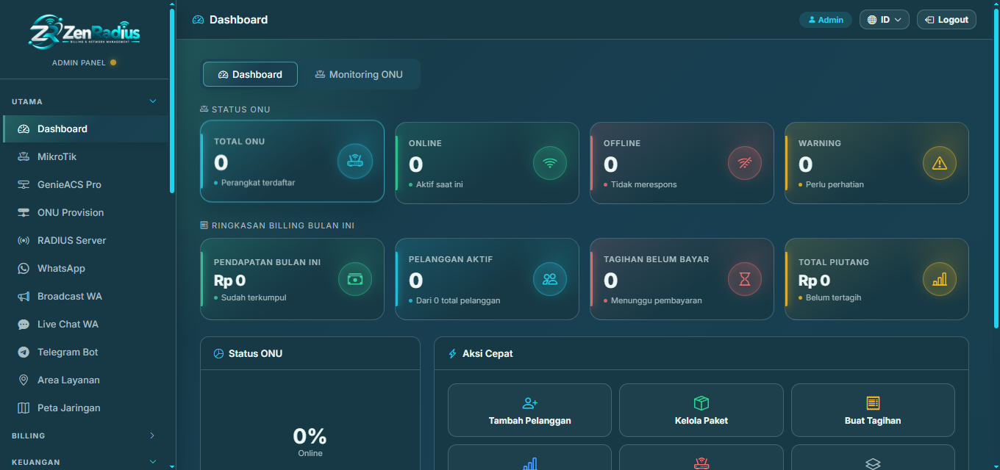
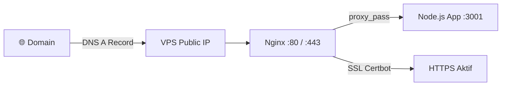
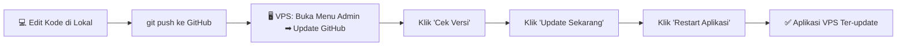

<div align="center">

# ZenRadius

**One Platform for Your Network** 🚀

Platform serba-satu untuk ISP: manajemen billing & tagihan, otomasi jaringan Mikrotik, billing Hotspot/PPPoE, **kasir Point of Sale (toko)**, serta **lima portal mandiri** (Pelanggan, Teknisi, Reseller, Kolektor, dan Kasir) — modern, responsif, dan siap produksi sebagai PWA (*Progressive Web App*).




</div>

---

### 🔗 Live Demo

**DEMO:** [https://demo.zenradius.net/admin](https://demo.zenradius.net/admin)
**LOGIN:** `zenradius` / `zenradius123`

---
## 📖 Daftar Isi

- [Fitur Utama](#-fitur-utama)
- [Daftar Modul & Portal](#-daftar-modul--portal)
- [Point of Sale / Toko](#-point-of-sale--toko)
- [Integrasi Payment Gateway](#-integrasi-payment-gateway)
- [Tumpukan Teknologi](#-tumpukan-teknologi)
- [Persyaratan Sistem](#-persyaratan-sistem)
- [Instalasi via install.sh (VPS/Production)](#-instalasi-via-installsh-vpsproduction)
- [Menjalankan via Docker](#-menjalankan-via-docker-alternatif)
- [Konfigurasi Domain & HTTPS](#-konfigurasi-domain--https)
- [Auto-Start Setelah Reboot Server](#-auto-start-setelah-reboot-server)
- [Update Aplikasi](#-update-aplikasi-setelah-deploy-ke-vps)
- [Dokumentasi & Tutorial Instalasi](#-dokumentasi--tutorial-instalasi)
- [Akun Akses Default](#-akun-akses-default)
- [Lisensi & Model Pembelian](#-lisensi--model-pembelian)

---

## ✨ Fitur Utama

### 🌐 Otomasi & Manajemen Jaringan (Mikrotik Integration)
| Fitur | Deskripsi |
|---|---|
| **PPPoE & Hotspot Billing** | Manajemen pembuatan voucher Hotspot otomatis (harian, mingguan, bulanan) dan akun PPPoE terpadu langsung dari dasbor administrasi. |
| **Isolir Otomatis** | Penangguhan otomatis akses internet pelanggan saat masa aktif paket berakhir, lengkap dengan pengalihan (*routing redirection*) menuju halaman Isolir. |
| **Auto-Polling Realtime** | Sinkronisasi status pembayaran QRIS yang andal untuk pembukaan isolir instan tanpa campur tangan admin. |

### 👤 Portal Pelanggan Terpadu (Customer Self-Service)
| Fitur | Deskripsi |
|---|---|
| **Simulasi Cerdas** | Membantu calon pelanggan menemukan paket internet (Normal, Streaming, Gaming, Bisnis) sesuai kebutuhan perangkat. |
| **Cek Tagihan Mandiri** | Akses instan untuk memeriksa invoice dan melakukan pembayaran via QRIS Statis maupun Virtual Account. |
| **Asisten Obrolan AI** | Chatbot responsif yang disematkan langsung di portal pelanggan untuk bantuan instan 24/7. |

### 💰 Billing, Tagihan & Keuangan
| Fitur | Deskripsi |
|---|---|
| **Tagihan Otomatis** | Pembuatan invoice bulanan/tempo, prorata invoice pertama, harga promo, serta pengingat jatuh tempo. |
| **Paket Fleksibel** | Kecepatan up/down, PPN & USO, FUP, night speed, dan penugasan profil router per paket. |
| **Isolir & Tunggakan** | Penangguhan otomatis plus pembukaan isolir instan begitu pembayaran terverifikasi. |
| **Laporan Keuangan** | Pendapatan, pengeluaran, laba/rugi, kas masuk, dan ekspor Excel/CSV. |
| **Payroll** | Slip gaji karyawan dengan tunjangan, potongan absensi, komisi kolektor, dan bonus tiket. |

### 🛒 Kasir Toko (Point of Sale)
Menyatu di panel admin (tepat di bawah menu **DigiFlazz**) untuk menjual perangkat jaringan, aksesoris, pulsa/token, atau kebutuhan toko. Ringkasnya: kasir multi-satuan (Pcs/Pak/Dus) dengan **harga grosir otomatis**, pembayaran **Tunai/QRIS Dinamis/Tempo**, **poin loyalti**, **pembelian supplier**, **piutang & hutang**, **shift kasir + Z-Report**, **retur & void**, dan **laporan laba bersih**. Selengkapnya di [Point of Sale / Toko](#-point-of-sale--toko).

### 🧑‍💼 Lima Portal Mandiri
Setiap peran mendapat antarmuka sendiri yang ringkas dan *mobile-first*, jadi tidak semua orang berbagi satu dashboard besar:

- **Portal Pelanggan** (`/`) — tagihan, voucher, top up, tiket gangguan, dan chatbot AI.
- **Portal Teknisi** (`/teknisi`) — daftar tugas, tiket baru, absensi, peta, dan monitor jaringan.
- **Portal Reseller** (`/mitra`) — saldo, penjualan voucher, serta pulsa/PPOB.
- **Portal Kolektor** (`/penagih`) — tagihan per wilayah, pencatatan setoran, dan absensi.
- **Akses Kasir** (`/admin`) — panel terbatas: tagihan, pelanggan, kas, tiket, dan Point of Sale.

Rincian lengkap tiap portal ada di [Daftar Modul & Portal](#-daftar-modul--portal).

### 🕒 Absensi & Manajemen Karyawan
| Fitur | Deskripsi |
|---|---|
| **Absensi Bergambar** | Check-in/out dengan foto, stempel lokasi (GPS), dan perhitungan durasi kerja. |
| **Manajemen Tim** | Data teknisi, kasir, kolektor, dan reseller beserta area kerja serta komisi. |

### 📱 Progressive Web App (PWA)
Mendukung instalasi mandiri (*standalone mode*) ke layar beranda perangkat mobile/desktop dengan branding sesuai peran pengguna:

| Peran | Nama Aplikasi |
|---|---|
| Pelanggan | **ZenRadius Client** |
| Administrator | **ZenRadius Admin** |
| Teknisi Lapangan | **ZenRadius Teknisi** |
| Reseller / Mitra | **ZenRadius Reseller** |
| Kolektor Keuangan | **ZenRadius Kolektor** |

Aset statis di-cache menggunakan strategi **Stale-While-Revalidate** untuk pengalaman akses yang instan tanpa jeda pembersihan berkas oleh pengguna akhir.

---

## 🧭 Daftar Modul & Portal

Seluruh modul dalam satu basis data. Menu dapat **disembunyikan, dikunci, atau diatur urutannya** per peran melalui **Pengaturan Sidebar** (`/admin/sidebar-settings`).

### Panel Admin — Section UTAMA

| Modul | Alamat | Hak Akses | Fungsi Singkat |
|---|---|---|---|
| **Dashboard** | `/admin` | Admin, Kasir | Ringkasan pelanggan, tagihan, pendapatan, dan grafik. |
| **MikroTik** | `/admin/mikrotik` | Admin, Kasir | Profil PPPoE/Hotspot, PPP Secret, DHCP, monitor resource router. |
| **GenieACS Pro** | `/admin/acs` | Admin | Manajemen perangkat ONU/ONT (TR-069) beserta tugas & parameter. |
| **ONU Provision** | `/admin/onu-provision` | Admin | Registrasi otomatis ONU, penugasan PPPoE, dan konfigurasi massal. |
| **Manajemen OLT** | `/admin/olts` | Admin | Pemantauan OLT (ZTE/Huawei/VSOL dan sejenisnya) dan data PON. |
| **RADIUS Server** | `/admin/radius-settings` | Admin, Kasir | NAS, akuntansi sesi, dan pengaturan autentikasi RADIUS. |
| **WhatsApp** | `/admin/whatsapp` | Admin, Kasir | Gateway WA (Baileys/Fonnte/Wablas/Meta), template pesan, koneksi. |
| **Broadcast WA** | `/admin/whatsapp/broadcast` | Admin, Kasir | Pengiriman pesan massal bertarget dengan penjadwalan. |
| **Live Chat WA** | `/admin/whatsapp/live-chat` | Admin, Kasir | Percakapan masuk/keluar dengan pelanggan dalam satu inbox. |
| **Gemini Bot** | `/admin/gemini-bot` | Admin | Asisten AI untuk operasional (perintah bahasa alami). |
| **Telegram Bot** | `/admin/telegram-bot` | Admin | Notifikasi dan backup ke Telegram. |
| **Area Layanan** | `/admin/areas` | Admin, Kasir | Pembagian wilayah kerja untuk teknisi dan kolektor. |
| **Peta Jaringan** | `/admin/map` | Admin, Kasir | Sebaran pelanggan, ODP, dan OLT dalam peta. |
| **Promo Slides** | `/admin/promo-slides` | Admin | Banner promo pada halaman login/portal pelanggan. |

### Panel Admin — Section BILLING

| Modul | Alamat | Hak Akses | Fungsi Singkat |
|---|---|---|---|
| **Pelanggan** | `/admin/customers` | Admin, Kasir | Data pelanggan, paket, perangkat, isolir, dan pendaftaran online. |
| **Paket Internet** | `/admin/packages` | Admin, Kasir | Paket kecepatan, harga, PPN/USO, FUP, night speed, promo. |
| **Paket Voucher** | `/admin/vouchers/packages` | Admin, Kasir | Template voucher Hotspot dan pembuatan massal. |
| **Tagihan** | `/admin/billing` | Admin, Kasir | Invoice bulanan, pembayaran, pengingat, dan tunggakan. |

### Panel Admin — Section LAYANAN

| Modul | Alamat | Hak Akses | Fungsi Singkat |
|---|---|---|---|
| **Tiket Customer** | `/admin/tickets` | Admin, Kasir | Tiket gangguan, penugasan teknisi, dan riwayat penanganan. |
| **Approval Kolektor** | `/admin/collector-payments` | Admin, Kasir | Verifikasi setoran pembayaran dari kolektor lapangan. |
| **Inventaris (Stok)** | `/admin/inventory` | Admin, Kasir | Stok perangkat ISP (ONU, router, kabel) beserta nomor seri. |
| **Cetak Stiker ONU** | `/admin/onu-stickers` | Admin, Kasir | Generator label QR/barcode perangkat untuk pelanggan. |
| **DigiFlazz** | `/admin/digiflazz` | Admin | Produk PPOB/pulsa/token dan transaksi staf. |
| **Point of Sale** | `/toko` | Admin, Kasir | Kasir toko ritel/grosir — lihat [bagian khusus](#-point-of-sale--toko). |

### Panel Admin — Section KEUANGAN

| Modul | Alamat | Hak Akses | Fungsi Singkat |
|---|---|---|---|
| **Laporan Keuangan** | `/admin/reports` | Admin, Kasir | Pendapatan, pengeluaran, laba/rugi, dan ekspor Excel/CSV. |
| **Laporan Kasir** | `/admin/cashiers/reports` | Admin, Kasir | Rekap setoran dan transaksi per kasir. |
| **Gaji & Payroll** | `/admin/payroll` | Admin | Slip gaji, tunjangan, potongan, komisi, dan bonus tiket. |
| **Kas Masuk** | `/admin/finance/cash-in` | Admin, Kasir | Pencatatan kas masuk di luar tagihan (mis. suntikan modal). |
| **Pengeluaran** | `/admin/finance/expenses` | Admin, Kasir | Biaya operasional dengan kategori dan filter periode. |
| **Kategori Pengeluaran** | `/admin/finance/expense-categories` | Admin | Pengelompokan jenis biaya (perangkat, utilitas, gaji, dll). |

### Panel Admin — Section MANAJEMEN USER & SISTEM

| Modul | Alamat | Hak Akses | Fungsi Singkat |
|---|---|---|---|
| **Akses Role** | `/admin/users` | Admin | Pengguna, peran, dan izin menu per akun. |
| **Teknisi / Kasir / Kolektor / Reseller** | `/admin/technicians`, `/admin/cashiers`, `/admin/collectors`, `/admin/agents` | Admin | Data karyawan dan mitra beserta komisi/fee. |
| **Absensi Karyawan** | `/admin/attendance` | Admin, Kasir | Kehadiran, foto, dan lokasi (*geotagging*). |
| **Payment Gateway** | `/admin/payment-gateway` | Admin | Kredensial gateway pembayaran otomatis. |
| **Payment QRIS Statis** | `/admin/payment-qris-static` | Admin | Payload/gambar QRIS statis merchant. |
| **Notifikasi E-Wallet** | `/admin/ewallet-logs` | Admin | Log notifikasi pembayaran masuk untuk rekonsiliasi. |
| **Backup & Recovery** | `/admin/backup` | Admin | Backup/restore basis data (unduh, unggah, Telegram). |
| **Monitoring Sistem** | `/admin/monitoring` | Admin | Kesehatan server, basis data, dan status layanan. |
| **Log Aktivitas** | `/admin/audit-logs` | Admin | Jejak audit perubahan dan aksi pengguna. |
| **Pengaturan** | `/admin/settings` | Admin | Identitas, WhatsApp, MikroTik, pajak, dan setelan umum. |
| **Tema Aplikasi** | `/admin/theme-settings` | Admin | Tema tampilan (Space/Orbit) dan warna aksen. |
| **Update System** | `/admin/update` | Admin | Pembaruan aplikasi langsung dari panel. |

### Lima Portal Mandiri

Masing-masing portal memiliki login, **PWA** sendiri, dan navigasi bawah khusus untuk perangkat mobile.

| Portal | Alamat | Untuk | Isi Utama |
|---|---|---|---|
| **Portal Pelanggan** | `/` | Pelanggan internet | Cek & bayar tagihan, simulasi paket, voucher, top up saldo, tiket gangguan, chatbot AI, notifikasi. |
| **Portal Teknisi** | `/teknisi` | Teknisi lapangan | Tugas saya, tiket baru (pool), absensi, peta, monitor jaringan, tambah pelanggan. |
| **Portal Reseller** | `/mitra` | Mitra/agen | Saldo, tagihan pelanggan, jual voucher, pulsa/PPOB, riwayat transaksi. |
| **Portal Kolektor** | `/penagih` | Kolektor keuangan | Daftar tagihan wilayah, pencatatan setoran, absensi. |
| **Akses Kasir** | `/admin` | Kasir | Panel admin versi terbatas: dashboard, tagihan, pelanggan, kas, tiket, dan Point of Sale. |

> **Catatan peran:** peran kanonik di basis data adalah `admin`, `customer_service`, `teknisi`, `pelanggan`, `reseller`, dan `kolektor`. Peran `customer_service` ditampilkan sebagai **Kasir** di antarmuka.

---

## 🛒 Point of Sale / Toko

Modul **Point of Sale (POS)** adalah kasir penjualan barang ritel — cocok untuk ISP yang juga menjual perangkat (router, kabel, adaptor), aksesoris, pulsa/token, atau kebutuhan toko lainnya.

POS berdiri sebagai **aplikasi mandiri**, bukan sub-halaman panel admin:

| Item | Keterangan |
|---|---|
| **Nama Menu** | Point of Sale |
| **Posisi Menu** | Sidebar admin → section **LAYANAN**, tepat di bawah **DigiFlazz**, dengan penanda ikon ↗ |
| **Cara Membuka** | Klik menu akan membuka **tab baru**, sehingga kasir tidak meninggalkan pekerjaan admin yang sedang berjalan |
| **Alamat Akses** | `https://domainanda.com/toko` (boleh dibuka/di-bookmark langsung) |
| **Hak Akses** | Administrator & Kasir (`customer_service`) — memakai sesi login yang sama, tidak perlu login ulang |
| **Tata Letak** | **Sidebar & topbar sendiri**, terpisah dari menu billing/MikroTik panel admin agar kasir tetap fokus pada pekerjaan toko |
| **Branding** | Nama & **logo toko sendiri**; bila logo belum diunggah, memakai logo aplikasi |
| **PWA** | Dapat dipasang sendiri sebagai **aplikasi kasir** (*standalone*), terpisah dari PWA panel admin |

Sidebar POS dikelompokkan per pekerjaan (Utama, Katalog & Stok, Keuangan, Analisis, Sistem) dan menampilkan lencana **Shift Aktif** serta ringkasan kas saat shift berjalan. Untuk keluar digunakan menu **Keluar** di bagian bawah sidebar.

### Fitur Utama POS

| Fitur | Deskripsi |
|---|---|
| **Kasir (POS)** | Antarmuka kasir satu layar: cari/scan produk, keranjang, diskon, tukar poin, hitung kembalian, dan cetak struk 80 mm. Dilengkapi **umpan suara** (bunyi pemindai & nada sukses) dan **pintasan keyboard** `F1` (proses bayar) / `F2` (kosongkan keranjang). |
| **Scan Barcode / SKU** | Kolom pencarian menerima input scanner barcode; menekan **Enter** langsung menambahkan produk yang paling cocok ke keranjang. |
| **Produk Cepat (Terlaris)** | Strip sekali-klik berisi produk terlaris 30 hari terakhir sehingga transaksi tersering tidak perlu dicari. |
| **Satuan Bertingkat** | Satu produk dapat memiliki beberapa satuan (mis. Pcs, Pak, Dus) beserta faktor konversi dan harga jual per satuan. |
| **Harga Grosir** | Harga khusus otomatis berlaku jika jumlah beli mencapai minimum grosir yang ditentukan per satuan. |
| **Tipe Pembayaran** | **Tunai (CASH)**, **QRIS**, dan **Tempo/Kredit (CREDIT)**. Tempo mendukung **uang muka** dengan status **PARTIAL** (beda dari UNPAID/belum bayar), jatuh tempo, sisa hutang, dan pembayaran cicilan. |
| **QRIS Dinamis (EMVCo)** | Mengubah QRIS statis merchant menjadi **QRIS dinamis bernominal pasti** (tag 54 + CRC16 dihitung ulang), sehingga pelanggan tidak perlu mengetik jumlah bayar. Bila payload tidak valid, sistem otomatis menampilkan QRIS statis sebagai cadangan. |
| **Program Loyalti** | Poin otomatis diperoleh dari nominal belanja; poin dapat ditukar menjadi potongan harga saat checkout. |
| **Manajemen Produk** | Kategori, SKU, harga pokok, harga jual, stok minimum, tanggal kedaluwarsa, dan penyesuaian stok dengan kartu stok (*stock log*). |
| **Impor & Ekspor Produk (CSV)** | Unduh seluruh produk (satu baris per satuan), sunting di Excel/spreadsheet, lalu impor kembali. Kategori baru dibuat otomatis, dan tersedia mode **upsert** (perbarui) atau **insert_only** (lewati yang sudah ada). |
| **Pembelian & Supplier** | Pencatatan pembelian dari supplier (tunai/tempo) yang otomatis menambah stok serta memperbarui harga pokok dan tanggal kedaluwarsa produk. |
| **Hutang & Piutang** | Daftar piutang pelanggan dan hutang supplier lengkap dengan form pembayaran angsuran. |
| **Kas & Pengeluaran** | Pencatatan pengeluaran operasional toko (listrik, gaji, transport, dll) dengan filter dan ringkasan per periode. |
| **Shift Kasir & Z-Report** | Buka/tutup shift dengan kas awal, kas seharusnya, kas aktual, dan selisih; riwayat shift tersimpan untuk audit. |
| **Laporan Penjualan** | Filter rentang tanggal, ringkasan **omzet bersih**, **laba bersih**, total retur, rekap per metode bayar, produk terlaris, rekap harian, serta **void** dan **retur** penjualan. |
| **Analisis Barang Lambat Laku** | Menampilkan produk yang masih menumpuk stok tetapi paling sedikit terjual, lengkap dengan nilai **modal tertahan** dan **berapa hari menganggur** — untuk memutuskan diskon, retur ke supplier, atau berhenti memesan ulang. |
| **Retur dengan Metode Pengembalian** | Retur barang per item dengan pilihan **Tunai** (kas keluar, otomatis tercatat sebagai pengeluaran agar kas shift tetap seimbang) atau **Potong Piutang** (untuk pelanggan yang masih berhutang). Nota asli tetap utuh sebagai jejak audit. |
| **Pelanggan Toko** | Data pelanggan POS, saldo poin, penyesuaian poin manual, dan riwayat mutasi poin. |
| **Keranjang Ditahan (Hold)** | Menahan beberapa transaksi sekaligus (mis. pelanggan lupa ambil barang) untuk dilanjutkan kapan saja. |
| **Kirim Struk via WhatsApp** | Struk ringkas dapat dikirim ke nomor pelanggan memakai gateway WhatsApp yang sudah aktif di ZenRadius (tanpa konfigurasi tambahan). |
| **Logo Toko Sendiri** | Unggah logo toko (PNG/JPG/WebP, maks 2 MB) di Pengaturan POS. Logo tampil di sidebar dan dapat dicetak pada struk. Terpisah dari logo aplikasi, jadi branding ZenRadius tidak berubah. |
| **Struk Thermal** | Halaman struk mandiri ukuran 80 mm (`/toko/struk/:id`) siap cetak, tanpa elemen sidebar. |
| **Aplikasi Kasir (PWA)** | POS punya manifest sendiri (`/toko/manifest.webmanifest`, scope `/toko/`) sehingga dapat dipasang ke layar beranda tablet/HP kasir dan berjalan *standalone* tanpa bilah peramban. |
| **Ramah Layar Sentuh** | Tampilan mobile dioptimalkan: sidebar menjadi panel geser (*drawer*), modal lebar penuh dengan tombol menumpuk, tabel dapat digulir mendatar, dan target sentuh tombol diperbesar. |
| **Pintasan & Umpan Suara** | `F1` memproses pembayaran, `F2` mengosongkan keranjang; tersedia bunyi pemindai dan nada transaksi berhasil. |

### Pengaturan POS

Menu **Pengaturan** (khusus administrator) di `/toko/pengaturan` mengatur identitas toko, footer struk, program loyalti, QRIS statis, dan operasional:

| Grup | Contoh Pengaturan |
|---|---|
| **Identitas Toko** | Nama toko (kosong = ikut nama perusahaan), alamat, telepon |
| **Logo Toko** | Unggah/ganti/hapus logo toko (PNG, JPG, WebP — maks 2 MB). Pratinjau tampil langsung. |
| **Struk** | Footer struk, cetak logo pada struk |
| **Loyalti** | Aktif/nonaktif, nominal belanja per 1 poin, nilai rupiah per poin |
| **Pembayaran** | Payload QRIS statis toko. Bila dikosongkan, modul toko otomatis memakai QRIS Statis global ZenRadius, sehingga merchant tidak perlu mengisi dua kali. |
| **Operasional** | Stok minimum default, persentase pajak, peringatan stok menipis |

### Catatan Teknis

- Seluruh tabel modul POS diberi awalan **`pos_`** (mis. `pos_products`, `pos_sales`, `pos_shifts`) agar tidak bertabrakan dengan tabel inventaris perangkat ISP yang sudah ada (`inventory_items`, `inventory_stock`, dan sejenisnya).
- Data POS berada pada **basis data ZenRadius yang sama**, sehingga laporan dan backup otomatis ikut terbawa tanpa proses sinkronisasi terpisah.
- Modul ini berdiri sendiri dari data pelanggan internet: pelanggan toko (*walk-in*) tidak otomatis menjadi pelanggan ISP.
- Logo toko disimpan di `public/uploads/branding/` (volume persisten saat Docker) dan disajikan lewat `/toko/logo` yang **memerlukan sesi** — bukan aset publik. Format berkas dideteksi dari isi (*magic bytes*), bukan dari nama berkas kiriman.
- Perubahan skema pada pembaruan versi ditangani **otomatis (auto-migrate)** saat aplikasi dijalankan — instalasi yang sudah berjalan cukup melakukan update dari panel admin, tanpa migrasi manual.

**Belum tersedia** (direncanakan pada versi berikutnya):

| Fitur | Keterangan |
|---|---|
| Cetak label barcode 33×15 mm | Generator label harga/barcode untuk ditempel di rak. Sementara ini gunakan **Cetak Stiker ONU** untuk perangkat jaringan, atau cetak via Excel dari hasil **Ekspor CSV**. |
| Kick cash drawer | Membuka laci uang otomatis saat struk dicetak (perlu printer ESC/POS atau WebUSB). |
| Impor Excel (`.xlsx`) | Saat ini memakai **CSV** yang bisa dibuka dan disimpan langsung oleh Excel. |

---

## 💳 Integrasi Payment Gateway

ZenRadius mendukung berbagai metode pembayaran otomatis untuk tagihan pelanggan maupun pembelian voucher publik — mulai dari payment gateway populer di Indonesia hingga QRIS Statis mandiri tanpa biaya transaksi tambahan.

### Payment Gateway Online (Otomatis Penuh)
| Gateway | Metode Didukung | Webhook Callback |
|---|---|---|
| **Tripay** | QRIS, Virtual Account (BCA/BNI/BRI/Permata/Mandiri), E-Wallet | `/customer/payment/callback` |
| **Midtrans (Snap)** | QRIS, Virtual Account, Kartu Kredit, E-Wallet | `/customer/payment/callback` |
| **Xendit** | QRIS, Virtual Account, Retail Outlet, E-Wallet | `/customer/payment/callback` |
| **Duitku** | QRIS, Virtual Account, E-Wallet | `/customer/payment/callback` |
| **iPaymu** | QRIS, DANA, ShopeePay, Virtual Account | `/customer/payment/callback` |
| **Digiflazz Payment** | QRIS, E-Money, Transfer Bank, Virtual Account | `/api/webhook/digiflazz-payment` |

Semua gateway di atas melakukan verifikasi **signature webhook** sebelum menandai tagihan/voucher sebagai lunas, serta otomatis memicu aktivasi ulang pelanggan yang sedang diisolir dan pengiriman notifikasi WhatsApp.

### QRIS Statis Mandiri (Semi-Otomatis, Tanpa Fee Gateway)
Selain payment gateway online, ZenRadius juga mendukung **QRIS Statis** dari akun e-wallet bisnis (mis. **DANA Bisnis**) yang di-upload/di-input langsung oleh admin — cocok untuk yang ingin menghindari biaya transaksi payment gateway pihak ketiga:

| Fitur | Deskripsi |
|---|---|
| **Kode Bayar Unik** | Setiap tagihan/voucher otomatis diberi nominal unik (+1–999 rupiah) agar pembayaran dapat dicocokkan otomatis tanpa perlu konfirmasi manual. |
| **QRIS Dinamis dari Payload Statis** | Jika payload QRIS statis diisi, sistem otomatis mengonversinya menjadi QRIS dinamis (nominal sudah terisi) saat pelanggan melakukan scan. |
| **Webhook DANA Bisnis** | Endpoint `/api/webhook/dana` menerima notifikasi pembayaran langsung dari dashboard DANA Bisnis — tanpa perlu aplikasi otomasi HP pihak ketiga (mis. MacroDroid). |
| **Webhook Generik (MacroDroid/SMS/dll)** | Endpoint `/api/webhook/v1/payment-notif` tersedia sebagai fallback untuk integrasi notifikasi lain (SMS banking, aplikasi otomasi HP) dengan proteksi `secret_key`. |
| **Monitoring Real-time** | Panel admin **Notifikasi E-Wallet** (`/admin/ewallet-logs`) menampilkan log seluruh notifikasi masuk (status parsing, nominal, invoice/voucher yang cocok, IP pengirim) dengan filter, live mode, dan notifikasi browser real-time. |

> 📄 Panduan detail setup DANA Bisnis: lihat `DANA_QRIS_INTEGRATION.md`. Panduan Digiflazz Payment Gateway: lihat `DIGIFLAZZ_PAYMENT_INTEGRATION.md`.

---

## 🛠 Tumpukan Teknologi

| Komponen | Teknologi |
|---|---|
| **Runtime** | Node.js v18+ |
| **Backend Framework** | Express.js |
| **Templating** | EJS |
| **Database** | SQLite 3 (`better-sqlite3`) |
| **UI Framework** | Bootstrap 5.3 + Bootstrap Icons |
| **PWA** | Service Worker + Web App Manifest |
| **Integrasi Jaringan** | Mikrotik RouterOS API |

---

## 💻 Persyaratan Sistem

| Kebutuhan | Spesifikasi |
|---|---|
| **Sistem Operasi** | Windows 10/11, Windows Server, atau Linux (Ubuntu/Debian) |
| **Runtime** | [Node.js](https://nodejs.org/) v18.x atau lebih baru (LTS direkomendasikan) |
| **Database** | SQLite 3 (via `better-sqlite3`) |
| **Reverse Proxy (Opsional)** | Nginx atau Apache (untuk SSL/HTTPS & sertifikat PWA) |
| **Hardware Minimum** | 1 vCPU, 1 GB RAM, 10 GB Storage |

---

## ⚡ Instalasi via install.sh (VPS/Production)

Cara resmi untuk deploy ZenRadius di VPS/server production adalah lewat `install.sh` yang tersedia di root repository. Skrip ini memasang seluruh kebutuhan sistem (Node.js, PM2, dan Nginx+Certbot bila diperlukan), memasang dependensi aplikasi, menyiapkan `.env`, memverifikasi database, lalu menjalankan aplikasi lewat **PM2** dengan auto-start saat reboot.

> `install.sh` tidak menjalankan `npm start`. Proses production sepenuhnya dikelola PM2 agar aplikasi otomatis restart saat crash atau server reboot.

### Langkah 1: Clone Repository
Bebas menentukan lokasi instalasi, disarankan di dalam `/opt`:
```bash
cd /opt
git clone https://github.com/zenradius/zenradius.git
cd zenradius
```

Jika ingin memisahkan beberapa aplikasi dalam satu server:
```bash
mkdir -p /opt/apps && cd /opt/apps
git clone https://github.com/zenradius/zenradius.git
cd zenradius
```

### Langkah 2: Jalankan Skrip Instalasi

**Mode Normal** — VPS belum punya reverse proxy, pakai Nginx + SSL otomatis:
```bash
chmod +x install.sh
sudo ./install.sh zenradius.net
```
Ganti `zenradius.net` dengan domain Anda. Jika argumen domain tidak disertakan, skrip akan menanyakan domain secara interaktif (bisa dikosongkan untuk mode tanpa domain/HTTPS).

**Mode Cloudflare Tunnel** — VPS sudah punya Cloudflare Tunnel + domain yang diarahkan ke tunnel tersebut:
```bash
chmod +x install.sh
sudo ./install.sh --cloudflare
```
Dalam mode ini, skrip tidak memasang atau menyentuh Nginx maupun Certbot sama sekali — domain dan HTTPS sepenuhnya menjadi tanggung jawab Cloudflare. Skrip hanya memastikan aplikasi berjalan di `localhost:<PORT>` agar bisa diteruskan oleh `cloudflared` yang sudah dikonfigurasi sebelumnya.

### Apa yang Dilakukan Skrip Ini
1. Validasi lingkungan — memastikan dijalankan dengan `sudo`, dari folder hasil clone repository yang benar, dan OS Ubuntu/Debian.
2. Domain wajib untuk mode normal — jika kosong, skrip meminta input interaktif; validasi format domain (menolak URL lengkap). Dilewati sepenuhnya pada mode `--cloudflare`.
3. Memasang Node.js 20 LTS, memperbarui npm ke versi **10.9.9** (npm 10.x selaras Node 20 LTS) bila diperlukan, lalu memasang build tools (`python3`, `make`, `g++`) dan PM2. Nginx & Certbot hanya dipasang pada mode normal.
4. Memasang dependensi aplikasi (`npm ci`/`npm install` mode production).
5. Menyiapkan `.env` dari `.env.example` jika belum ada — tidak menimpa `.env` yang sudah dikonfigurasi.
6. Menjalankan `scripts/verify-database.js`.
7. Konfigurasi Nginx + SSL otomatis (hanya mode normal, hanya jika domain diisi) — dilewati jika sudah ada dari instalasi sebelumnya.
8. Menjalankan aplikasi via PM2 (`pm2 start`/`pm2 reload`), lalu `pm2 save` + `pm2 startup` agar aplikasi otomatis hidup kembali saat VPS reboot.

> Pada mode Cloudflare, `install.sh` tidak memasang/mengonfigurasi `cloudflared` itu sendiri. Pastikan Cloudflare Tunnel sudah disiapkan lebih dulu dan diarahkan ke port aplikasi (`PORT` di `.env`, default `3001`).

### Aman Dijalankan Berulang Kali
Skrip ini tidak menimpa data yang sudah ada saat dijalankan ulang:
* `.env`, `database/`, `public/uploads/`, `auth_info_baileys/` (sesi WhatsApp) — dibiarkan apa adanya
* Konfigurasi Nginx & sertifikat SSL yang sudah ada — dilewati, tidak dibuat ulang
* Aplikasi yang sudah dikenal PM2 — di-reload, bukan dijalankan sebagai proses baru

> Update kode selanjutnya cukup dilakukan lewat menu **Update GitHub** di panel admin (`/admin/update`) — bukan menjalankan ulang `install.sh` maupun `git pull` manual tanpa restart PM2.

---

## 🐳 Menjalankan via Docker (Alternatif)

Selain instalasi manual di atas, ZenRadius juga sudah menyediakan `Dockerfile` dan `compose.yaml` sehingga Anda bisa menjalankan aplikasi tanpa perlu memasang Node.js secara langsung di server.

### Persyaratan
* [Docker Engine](https://docs.docker.com/engine/install/) v20+
* [Docker Compose](https://docs.docker.com/compose/install/) v2+ (biasanya sudah bundel dengan Docker Desktop / `docker compose` plugin)

### Langkah 1: Clone Repositori
```bash
git clone https://github.com/zenradius/zenradius.git
cd zenradius
```

### Langkah 2: Konfigurasi Environment
```bash
cp .env.example .env    # Linux/Mac
copy .env.example .env  # Windows CMD/PowerShell
```
Sesuaikan nilai `.env` sesuai kebutuhan (kredensial admin, secret webhook, port, dll). Pada `NODE_ENV=production` aplikasi **menolak start** jika `SESSION_SECRET` atau `SETTINGS_MASTER_KEY` masih kosong/placeholder — isi keduanya dengan string acak yang panjang.

Buat juga `settings.json` awal **sebelum** container dijalankan (nilai lain diisi otomatis oleh aplikasi saat start). `compose.yaml` me-mount berkas ini secara bind; jika berkas belum ada, Docker akan membuat **direktori** kosong bernama `settings.json` dan aplikasi gagal membaca konfigurasi:
```bash
echo '{"server_port": 3001}' > settings.json                    # Linux/Mac
Set-Content settings.json '{"server_port": 3001}' -Encoding ascii  # Windows PowerShell
```
Nilai `server_port` harus sama dengan `PORT` di `.env` dan port yang dipublikasikan di `compose.yaml`.

### Langkah 3: Build & Jalankan Container
```bash
docker compose up -d --build
```
Perintah ini akan:
* Build image dari `Dockerfile` (Node.js 20 + npm 10.x + dependency native seperti `better-sqlite3`)
* Menjalankan container `zenradius-app` di background (`-d`)
* Mem-bind port `127.0.0.1:3001` ke container (gunakan reverse proxy Nginx/Apache untuk expose ke publik dengan HTTPS)
* Mount volume persisten: `settings.json`, `database/`, `data/`, `public/uploads/`, `auth_info_baileys/` — sehingga data **tidak hilang** saat container di-rebuild
* Menjalankan **health check** otomatis ke endpoint `/health` setiap 30 detik

### Langkah 4: Verifikasi Container Berjalan
```bash
docker compose ps
docker compose logs -f zenradius
```
Aplikasi dapat diakses melalui **`https://yourdomain.com`** (setelah dikonfigurasi reverse proxy) atau `http://127.0.0.1:3001` secara lokal di server.

### Perintah Operasional Umum
| Aksi | Perintah |
|---|---|
| Hentikan container | `docker compose down` |
| Restart container | `docker compose restart zenradius` |
| Lihat log real-time | `docker compose logs -f zenradius` |
| Masuk ke shell container | `docker compose exec zenradius sh` |
| Update ke versi terbaru | `git pull && docker compose up -d --build` |

> 💡 **Tip:** Jika menggunakan fitur **Update GitHub** di panel admin saat berjalan via Docker, pastikan container memiliki akses `git` dan proses restart dilakukan melalui `docker compose restart zenradius` (bukan PM2), karena aplikasi di dalam container tidak dikelola oleh PM2.

---

## 🌐 Konfigurasi Domain & HTTPS

Secara default aplikasi hanya berjalan di `127.0.0.1:3001` (baik mode manual maupun Docker) — **belum otomatis** dapat diakses via domain custom. Diperlukan **reverse proxy + SSL** agar aplikasi bisa diakses publik melalui `https://yourdomain.com` dan agar fitur PWA (install ke home screen) dapat berfungsi (PWA mewajibkan HTTPS).



### 1️⃣ Arahkan Domain ke VPS (DNS)
Di panel DNS domain Anda (Cloudflare, Niagahoster, dll), buat record:
```
Type: A
Name: @ (atau subdomain, misal: app)
Value: <IP_Publik_VPS_Anda>
```

### 2️⃣ Pasang & Konfigurasi Nginx (Reverse Proxy)
```bash
sudo apt update && sudo apt install nginx -y
```

Buat berkas konfigurasi baru `/etc/nginx/sites-available/zenradius`:
```nginx
server {
    listen 80;
    server_name yourdomain.com www.yourdomain.com;

    location / {
        proxy_pass http://127.0.0.1:3001;
        proxy_http_version 1.1;
        proxy_set_header Upgrade $http_upgrade;
        proxy_set_header Connection 'upgrade';
        proxy_set_header Host $host;
        proxy_set_header X-Real-IP $remote_addr;
        proxy_set_header X-Forwarded-For $proxy_add_x_forwarded_for;
        proxy_set_header X-Forwarded-Proto $scheme;
        proxy_cache_bypass $http_upgrade;
    }
}
```

Aktifkan konfigurasi:
```bash
sudo ln -s /etc/nginx/sites-available/zenradius /etc/nginx/sites-enabled/
sudo nginx -t
sudo systemctl reload nginx
```

### 3️⃣ Aktifkan HTTPS (SSL Gratis via Let's Encrypt)
```bash
sudo apt install certbot python3-certbot-nginx -y
sudo certbot --nginx -d yourdomain.com -d www.yourdomain.com
```
Certbot otomatis memperbarui konfigurasi Nginx untuk HTTPS dan mengelola **auto-renewal** sertifikat setiap ± 60 hari.

### 4️⃣ Perbarui Variabel Environment
Pastikan nilai terkait URL aplikasi pada `.env` menggunakan domain HTTPS final, misalnya:
```dotenv
APP_URL=https://yourdomain.com
```

> ✅ **Setelah setup ini dilakukan satu kali**, domain akan otomatis tetap berfungsi setiap kali VPS/container restart — Nginx dan sertifikat SSL berjalan sebagai service permanen di VPS, tidak perlu diulang manual.

---

## 🔁 Auto-Start Setelah Reboot Server

Agar aplikasi **otomatis kembali berjalan** saat VPS mati listrik/direstart, konfigurasi berikut wajib disiapkan sesuai metode deploy yang digunakan.

| Metode Deploy | Otomatis Jalan Saat Server Reboot? |
|---|---|
| **Docker Compose** (`restart: unless-stopped`) | ✅ Ya, otomatis (asalkan Docker service ter-enable) |
| **`install.sh`** (PM2 dikonfigurasi otomatis) | ✅ Ya, otomatis — tidak perlu setup tambahan |
| **Manual (`npm start`, tanpa PM2)** | ❌ Tidak — aplikasi mati total, perlu start manual |

### 🐳 Opsi A: Docker Compose (Direkomendasikan)
`compose.yaml` sudah dikonfigurasi dengan `restart: unless-stopped`, sehingga container otomatis restart saat crash maupun saat server reboot — asalkan **Docker daemon** sendiri otomatis aktif saat boot:
```bash
sudo systemctl is-enabled docker
# jika hasilnya belum "enabled":
sudo systemctl enable docker
```
Tidak ada langkah tambahan lain — setelah ini, aplikasi akan otomatis hidup kembali tanpa intervensi manual.

### ⚙️ Opsi B: `install.sh` (Sudah Otomatis)
Jika Anda men-deploy menggunakan `install.sh` (lihat bagian [Instalasi via install.sh](#-instalasi-via-installsh-vpsproduction)), **PM2 sudah otomatis dikonfigurasi** untuk auto-start saat reboot — tidak ada langkah tambahan yang perlu dilakukan.

Jika Anda menjalankan aplikasi secara manual di luar `install.sh` (langsung `node app-customer.js`), pasang PM2 sendiri:
```bash
npm install -g pm2
pm2 start app-customer.js --name zenradius
pm2 save
pm2 startup
```
Perintah `pm2 startup` akan menampilkan satu baris perintah `sudo` — jalankan perintah tersebut satu kali untuk mendaftarkan PM2 sebagai service sistem (systemd).

### ✅ Verifikasi
Uji dengan me-reboot server:
```bash
sudo reboot
```
Setelah server kembali online, cek status:
```bash
# Docker
docker compose ps

# PM2
pm2 list
```
Aplikasi seharusnya berstatus **running** tanpa perlu login/start ulang secara manual.

---

## 🔄 Update Aplikasi (Setelah Deploy ke VPS)

ZenRadius memiliki fitur **Update GitHub** bawaan di panel admin, sehingga Anda **tidak perlu SSH manual** setiap kali ada perubahan kode. Alurnya:



### Syarat Awal di VPS (Sekali Setup)
Pastikan aplikasi di VPS berjalan dari hasil `git clone`, **bukan** hasil upload manual/zip:
```bash
cd /path/to/zenradius
git remote -v   # pastikan menunjuk ke https://github.com/zenradius/zenradius.git
```
Jika belum, clone ulang dan pindahkan folder `database/`, `.env`, `public/uploads`, serta `auth_info_baileys` (sesi WhatsApp) ke lokasi hasil clone.

### Langkah Update via Panel Admin
1. **Di lokal:** selesaikan perubahan, lalu jalankan:
   ```bash
   git add .
   git commit -m "deskripsi perubahan"
   git push
   ```
2. **Login ke Panel Admin VPS** → buka menu **☁️ Update GitHub** (`/admin/update`).
3. Klik **Cek Versi** — sistem akan membandingkan `version.txt` lokal VPS dengan `origin/<branch>` di GitHub.
4. Jika status menunjukkan **"Ada update"**, klik **Update Sekarang**.
   * Sistem otomatis **backup** file penting (`settings.json`, `.env`, `database/`, `public/uploads`, `public/img`, `data`, sesi WhatsApp) sebelum menarik kode terbaru.
   * Kode ditarik via `git reset --hard origin/<branch>`, lalu file yang di-backup dikembalikan.
   * Jika `package.json` berubah, `npm install` otomatis dijalankan.
5. Setelah proses selesai, klik **Restart Aplikasi** agar perubahan diterapkan (proses PM2/Node di-restart otomatis oleh sistem).

> 💡 **Tip:** Gunakan bagian **Official Release Channel** di halaman yang sama jika ingin proses update yang lebih ketat (verifikasi checksum/signature rilis resmi) dengan restart otomatis + health check pasca-update.

> ⚠️ **Catatan:** Pastikan koneksi internet VPS stabil selama proses update berlangsung, dan hindari menutup halaman sebelum status menunjukkan selesai.

---

## 📘 Dokumentasi & Tutorial Instalasi

Panduan lengkap untuk memasang ZenRadius di VPS, mengonfigurasi seluruh modul (MikroTik, RADIUS, ACS TR-069, WhatsApp, payment gateway), dan mengoperasikannya sehari-hari tersedia di pusat dokumentasi resmi:

### 👉 [Dokumentasi ZenRadius](https://zenradius.net/dokumentasi)

Dokumentasi mencakup persiapan server, instalasi via `install.sh`, Docker Compose, konfigurasi domain dan HTTPS, Cloudflare Tunnel, MikroTik, RADIUS, ACS TR-069, WhatsApp, payment gateway, backup, keamanan, troubleshooting, dan checklist go-live.

> Disarankan mengikuti dokumentasi secara berurutan dari persiapan server hingga checklist go-live.

---

## 🔐 Akun Akses Default

Gunakan kredensial berikut untuk login pertama kali ke **Pusat Administrasi ZenRadius**:

| Item | Nilai |
|---|---|
| **URL Login** | `https://yourdomain.com/admin/login` |
| **Username** | `zenradius` |
| **Password** | `zenradius123` |

> ⚠️ **Penting:** Segera ubah kredensial default ini melalui menu pengaturan dasbor admin setelah berhasil masuk, demi keamanan basis data dan router Mikrotik Anda.

---

## 📝 Lisensi & Model Pembelian

ZenRadius adalah produk berbayar berlisensi proprietari menggunakan model pembelian **Aktivasi Lisensi Sekali Bayar untuk Selamanya (Lifetime License)**. 

### Ketentuan Lisensi:
1. **Satu Lisensi per Domain**: Pembelian lisensi diikat secara ketat pada satu host kustom / FQDN (misalnya: `billing.ispanda.net`).
2. **Aktif Selamanya (Lifetime)**: Tidak ada biaya bulanan, tidak ada tarif berlangganan tahunan, dan tidak ada biaya tersembunyi. Sekali diaktifkan, lisensi valid selamanya.
3. **Pembaruan Berkelanjutan Gratis**: Tetap mendapatkan akses pembaruan fitur (update via git), tambalan sistem keamanan, serta perbaikan bug tanpa perlu membayar ekstra.
4. **Masa Tenggang Integratif (Grace Period)**: Instalasi baru ZenRadius tanpa kunci serial valid akan memasuki *masa tenggang selama 30 hari* dengan fungsionalitas penuh — cukup untuk mengevaluasi seluruh fitur selama sebulan. Setelah masa tenggang berakhir, sistem akan mengunci akses ke panel admin secara otomatis sampai serial yang sah selesai diaktivasi.

### 💰 Informasi Harga dan Pemesanan:
*   **Investasi**: **Rp 300.000 / Domain** (Lisensi Premium Aktif Selamanya)
*   **Cara Pemesanan**: Klik tombol **Order Lisensi** langsung dari halaman Pengaturan admin ZenRadius Anda, atau hubungi Developer resmi via WhatsApp di **+62 851-7800-8881**.

---

Hak Cipta © 2026 ZenRadius — All Rights Reserved.

<div align="center">

**Ditenagai oleh ZenRadius — All Rights Reserved**

</div>
